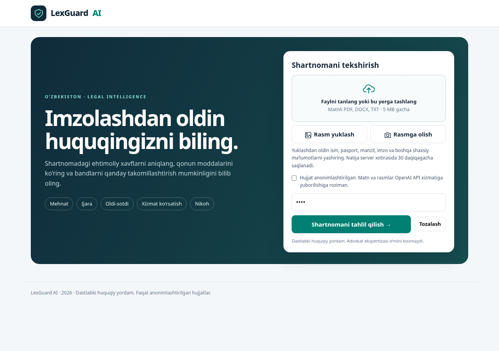
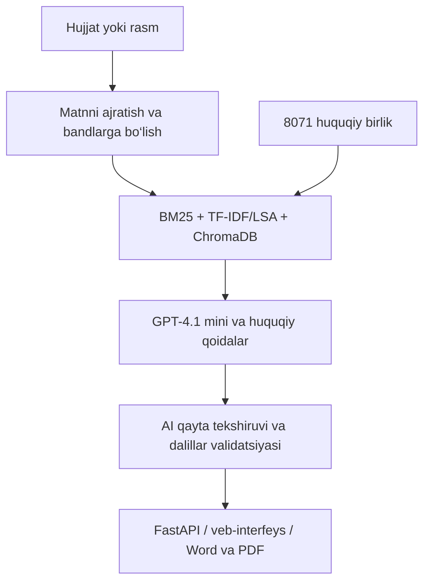
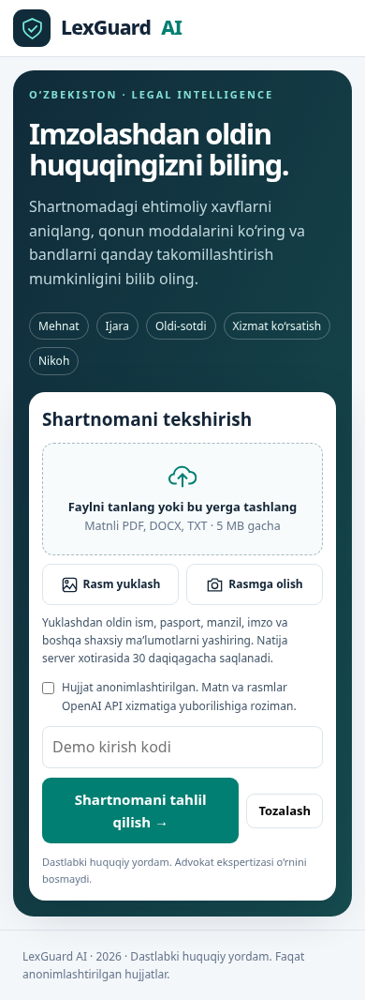

# LexGuard AI

**Imzolashdan oldin huquqingizni biling.**

O‘zbekiston qonunchiligiga tayangan holda shartnomalardagi ehtimoliy huquqiy xavflarni aniqlash va tushuntirish uchun ishlab chiqilgan LegalTech MVP. Hackathon 2026 — huquqiy xizmatlarni ko‘rsatish yo‘nalishi.

**Holat:** ishlaydigan prototip · **Interfeys:** o‘zbekcha · **Texnologiyalar:** Python, FastAPI, gibrid qidiruv, OpenAI API

[Imkoniyatlar](#imkoniyatlar) · [Natijalar](#natijalar) · [Ishga tushirish](#windows-tez-ishga-tushirish) · [Cheklovlar](#maxfiylik-va-cheklovlar)



## Imkoniyatlar

- Mehnat, ijara, oldi-sotdi, xizmat ko‘rsatish va nikoh shartnomalari.
- PDF, DOCX, TXT; JPG/PNG va telefon kamerasi orqali 5 tagacha sahifa. Rasmdan ajratilgan matnni tasdiqlash va tahrirlash.
- Bandma-band tahlil: ehtimoliy xavf, huquqiy asos, tavsiya va LexUZ manbasi.
- Word va PDF hisobotlar; mobil qurilmalarga mos veb-interfeys.
- Bir vaqtda bitta faol AI tahlili; demo rejimi.

## Arxitektura



Korpus: Mehnat kodeksi 3028, Fuqarolik kodeksi I qism 1252, II qism 2649, Uy-joy kodeksi 549, Oila kodeksi 593. Jami 8071 matn birligi (moddalar soni emas). Semantik vektorlar 96 o‘lchamli LSA; neyron embedding deb talqin qilinmaydi. Korpus amaldagi rasmiy tahrirga to‘liq solishtirilmagan.

Manba va tekshiruv holati: [Korpus haqida](docs/DATA_SOURCES.md).

## Natijalar

| Sinov | Natija |
| --- | --- |
| V3: 7 sintetik shartnoma, 94 birlik | 25 TP, 3 FP, 12 FN, 42 TN, 22 noaniq (noaniq pozitivlar FN ichida) |
| V3: qidiruv Hit@5 | 36/36 korpusdagi kutilgan modda |
| V3: Precision / Recall / F1 | 89.29% / 67.57% / 76.92% |
| V3.1: maqsadli qayta sinov | 8/8 xavfli, 3/3 nazorat bandi |

V3.1 natijasi 11 ta avval muammo kuzatilgan band bo‘yicha regressiya sinovi; mustaqil test yoki umumiy 100% aniqlik emas. To‘liq V3.1 benchmark o'tkazilmagan.

## Windows: tez ishga tushirish

1. Python 3.12 yoki 3.13 (64-bit) o‘rnating.
2. Repozitoriyni klonlang yoki Download ZIP orqali yuklab, arxivdan chiqaring.
3. `ISHGA_TUSHIRISH.bat` faylini oching. Birinchi safar virtual muhit, paketlar va siqilgan ChromaDB snapshot avtomatik tiklanadi.
4. O‘zingizning OpenAI API kalitingizni konsolda kiriting. Kalit diskka yozilmaydi.
5. Lokal sayt ochiladi. Ixtiyoriy Cloudflare Quick Tunnel vaqtinchalik HTTPS manzil va QR hosil qiladi. Demo kodi: 2026.

> `2026` kodi faqat lokal taqdimot uchun. Internetga ochiladigan serverda alohida tasodifiy token tanlang va hujjatlarni avval anonimlashtiring.

Faqat lokal: `ISHGA_TUSHIRISH.bat --local-only`. Qidiruvning diskdagi BM25+LSA zaxira rejimi: `ISHGA_TUSHIRISH.bat --offline`. Bu rejim ham AI uchun internet talab qiladi.

## Linux / macOS / Colab: qo‘lda ishga tushirish

Repozitoriy ildizida:

```bash
python -m pip install -r requirements-mvp.txt reportlab 'chromadb>=1.0,<2.0'
python restore_indexes.py
```

`OPENAI_API_KEY` ni maxfiy muhit o‘zgaruvchisi sifatida sozlang (Colab: Secrets). `LEXGUARD_DEMO_TOKEN` ni demo uchun sozlang; ommaviy xizmatda kuchli autentifikatsiya kerak. So‘ng:

```bash
export LEXGUARD_DEMO_TOKEN=2026
export LEXGUARD_BACKEND=chroma
python -m uvicorn lexguard_mvp:app --host 127.0.0.1 --port 7862 --workers 1 --no-access-log
```

Lokal manzil: http://127.0.0.1:7862 ; servis holati: `/health`. Colab uchun `colab_demo.py` yordamchi modul mavjud. `restore_indexes.py` indeksning 33 MB SQLite faylini siqilgan nusxadan SHA-256 tekshiruvi bilan tiklaydi. Backend algoritmi o‘zgartirilmagan.

## Fayl tuzilishi

| Fayl / papka | Vazifasi |
| --- | --- |
| `openai_analyzer_v31.py` | AI tahlili, qoidalar va validator |
| `legal_retrieval_v3.py`, `retriever.py` | Gibrid qidiruv |
| `contract_analyzer.py` | Hujjatni o‘qish va segmentlash |
| `lexguard_mvp.py`, `lexguard_api.py` | FastAPI, rasm va tahlil, hisobot endpointlari |
| `web/` | Interfeys |
| `data/`, `indexes/` | Korpus va tayyor indekslar |
| `pdf_report.py`, `docx_report.py` | Hisobotlarni generatsiya qilish |
| `OFLAYN_DEMO.html` | Arxiv natijasi; yangi hujjatni tahlil qilmaydi |
| `docs/` | Oldingi bosqichlar bo‘yicha texnik hujjatlar |

## Maxfiylik va cheklovlar

Faqat shaxsiy ma’lumotlari oldindan yashirilgan hujjatlarni yuklang. Matn/rasm tashqi OpenAI API orqali qayta ishlanadi. 2026 kodi hackathon demosiga mo‘ljallangan, ishlab chiqarish muhiti uchun yetarli himoya emas. Jonli tahlil uchun API balansi va internet talab qilinadi. Quick Tunnel doimiy hosting emas. Tahlil 30 tagacha band bilan cheklangan; natijalar professional yuridik ekspertiza o‘rnini bosmaydi. GitHub repozitoriysiga kalitlar, haqiqiy shartnomalar, tahlil hisobotlari va maxfiy ma'lumotlarni joylamang. Ommaviy ulashdan oldin kod, ma'lumotlar va uchinchi tomon materiallarini tarqatish huquqini tekshiring.

## Interfeys


